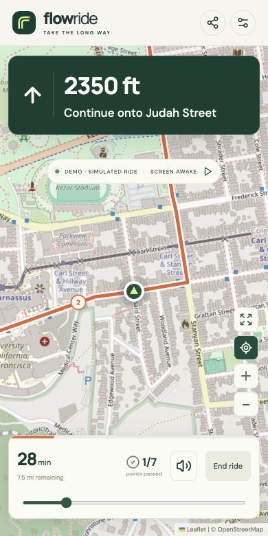
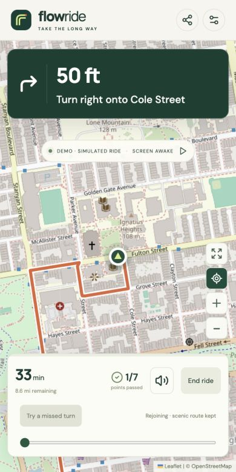

# Flow Ride

**Take the long way. Keep the good roads.**

Scenic motorcycle navigation with automatic pass-through points. Miss a turn and Flow Ride finds a connection back to your ride while preserving the remaining scenic roads and waypoints. No stop confirmations to dismiss.

[Try the app](https://ride.skeptrune.com) · [Report an issue](https://github.com/skeptrunedev/flowride/issues) · [Contribute](CONTRIBUTING.md)

[](https://github.com/skeptrunedev/flowride/actions/workflows/ci.yml)
[](LICENSE)

<p align="center">
  
  
</p>

## What it does

- **Ride through your points.** Intermediate waypoints clear automatically as you pass them.
- **Keep the scenic route.** Automatic recovery recalculates only the connection back, keeping the remaining route geometry and turns.
- **Shape your ride.** Place a start, finish and up to 18 pass-through points on the map, then build a driving route.
- **Hear the next turn.** Spoken directions use your device's speech synthesis. A screen wake lock is requested when supported.
- **Try it without riding.** The demo simulates GPS progress; “Try a missed turn” exercises the same rerouting pipeline using a simulated location.
- **Share or export.** Share a route link or download a GPX track.

The included San Francisco ride heads south through Parnassus, Laguna Honda, Portola and Upper Market, then finishes near Market Street. Its roughly 35-minute estimate excludes live traffic.

## Run locally

Use Node.js **22.12+** (Node 24 recommended) and npm. No API key or backend is required for the demo.

```sh
git clone https://github.com/skeptrunedev/flowride.git
cd flowride
npm ci
npm run dev
```

Open the local URL printed by Vite. For phone GPS, use an HTTPS deployment; a plain HTTP LAN address does not provide the secure context required by location APIs.

```sh
npm test             # navigation and recovery tests
npm run format:check # source formatting
npm run build        # production files in dist/
npm run preview      # inspect the production build locally
```

## How recovery works

1. Match accurate GPS readings to the route and track progress along its geometry.
2. Confirm a missed turn using at least three accurate off-route readings over four seconds, avoiding reactions to a single GPS jump.
3. Select a rejoin point ahead of the last matched position, without jumping beyond an unvisited scenic point.
4. Ask OSRM for a driving connection from the rider to that point, using heading constraints where available.
5. Join the connection to the original route's remaining geometry and maneuvers.

Pending requests are canceled when the ride ends, GPS becomes unreliable, or the rider rejoins the old route. Failures retry after a cooldown. Responses for a location the rider has already left are discarded. There is no intermediate arrival dialog.

## Deploy to Cloudflare

The app is a static Vite build served by Cloudflare Workers Static Assets. The included `wrangler.jsonc` is portable and contains no account IDs or credentials.

```sh
npx wrangler login
npm run deploy
```

Choose your Cloudflare account when prompted. This publishes the `flow-ride` Worker on your account's `workers.dev` subdomain. Change `name` in `wrangler.jsonc` if that Worker name is already in use.

To use a domain you control in Cloudflare, add a custom domain in the dashboard or add a `routes` entry to your own Wrangler configuration:

```json
{
  "routes": [{ "pattern": "ride.example.com", "custom_domain": true }]
}
```

For automated deployments, supply `CLOUDFLARE_API_TOKEN` and `CLOUDFLARE_ACCOUNT_ID` through your deployment environment. Keep credentials out of source and all `VITE_*` variables, which are exposed to the browser. The GitHub workflow only checks the app; it does not deploy it.

## Project layout

| Path                       | Purpose                                                               |
| -------------------------- | --------------------------------------------------------------------- |
| `src/App.jsx`              | Route editor, map, ride UI, GPS and browser integrations              |
| `src/navigation.js`        | Route compilation, matching, progress and turn instructions           |
| `src/rerouting.js`         | Rejoin selection, exact route-tail preservation and request lifecycle |
| `src/style.css`            | Responsive desktop and phone layouts                                  |
| `tests/`                   | Deterministic navigation and rerouting tests                          |
| `public/scenic-route.json` | Bundled example route from OSRM                                       |
| `wrangler.jsonc`           | Cloudflare static hosting configuration                               |

## Privacy and service limits

GPS progress is processed on the device; Flow Ride does not store GPS history. Selected plans are saved in browser local storage. Rerouting sends the current location and rejoin point to the public OSRM service. Route editing sends the selected route points. Shared links include selected route coordinates in their URL fragment. OpenStreetMap receives requests for map tiles in the viewed area.

Keep the page visible and the screen on during navigation. This is a browser prototype: background and locked-screen navigation are not supported. Routing uses driving rules, not motorcycle-specific restrictions. There is no live traffic, closure detection, offline basemap or navigation-grade map matching. Follow posted signs.

Rerouting and new route calculations require internet access. Travel time is the routing duration multiplied by 1.3 for a modest city-riding buffer, not a live ETA. Public OSRM and OpenStreetMap tile services are external dependencies; use dedicated services before scaling. Tiles are fetched only for the visible map, without offline downloading or prefetching.

## Verification

The test suite covers complete simulated rides, silent intermediate arrivals, weak and stale GPS, progress bounds, joining mid-route, exact preservation of scenic route tails, repeated recovery, cancellation, retry cooldowns and stale network responses. Browser checks cover the phone layout and a simulated missed turn against the real routing service.

Physical on-road GPS, Bluetooth speech and device-specific wake locks still need real-device testing.

## License and credits

Application code is [MIT licensed](LICENSE), © 2026 skeptrunedev. Map data and third-party dependencies retain their own licenses; see [NOTICE.md](NOTICE.md).

Built with [React](https://react.dev), [Vite](https://vite.dev), [Leaflet](https://leafletjs.com), [Lucide](https://lucide.dev), [OSRM](https://project-osrm.org) and [OpenStreetMap](https://www.openstreetmap.org/copyright).
